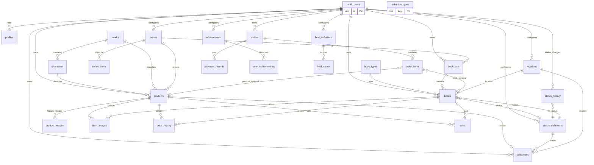
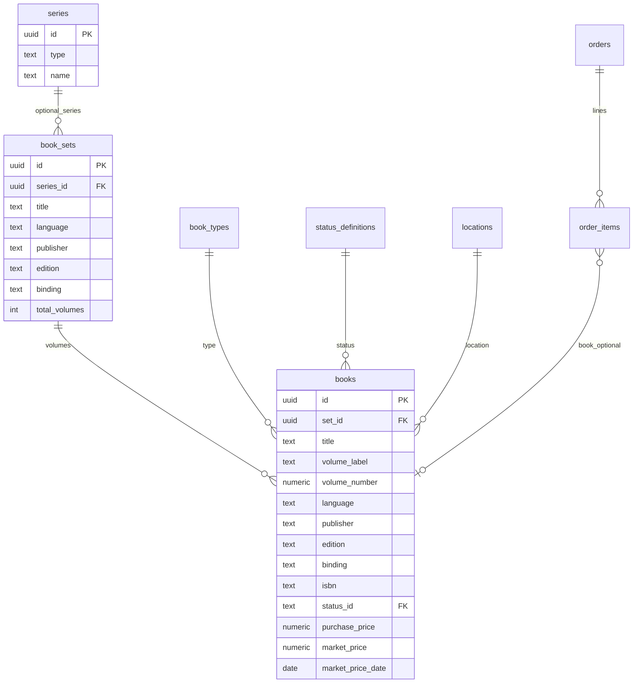

# 02 · V6 数据模型、ER 图与表设计

> 原则：**保留 V5 原表与 1537 条数据；V6 只做增量表/列。**
> 本文是设计，不是已执行的数据库结构；P1 才生成可执行 SQL。

## 1. 设计原则

1. **谷子不迁移**：`products` 继续保存 1537 条谷子，不改主键、不改 ID。
2. **书籍另建表**：书籍不是商品；不塞进 `products`，避免破坏 `collections.product_id` 外键。
3. **配置与数据分离**：状态、分类、字段、徽章、地点都是「定义表 + 使用表」。
4. **可扩展类型**：`collection_types` + 统一视图；未来新增类型不重写统计逻辑。
5. **软删除优先**：主要实体加 `deleted_at`；回收站恢复，永久删除才真删。
6. **金额用流水**：定金/尾款/退款不覆盖一个「已付总额」，而是 `payment_records`。
7. **版本不合并**：书籍语言/出版社/版次/装帧是独立字段；重复检测只提示，不自动合并。
8. **备份即真相**：所有配置、定义、流水、软删除记录都进入 v4 备份。

## 2. 总体 ER 图（核心）



> 多态关系（`order_items.entity_id`、`item_images.entity_id`、`price_history.entity_id`、`sales.entity_id`、`field_values.entity_id`）在数据库里用 `entity_type + entity_id` 表达，不能直接用单列外键；完整性由应用层 + 校验触发器保证。

## 3. 书籍套 / 卷 / 版本 ER 图



### 3.1 书籍模型规则

- **独立单本**：`books.set_id = null`，`volume_label = null`，直接记录书名、作者、出版社、版次、ISBN。
- **套书**：先建 `book_sets`，再建多条 `books`，每条对应一卷；`books.set_id` 指向套书。
- **系列**：`series` 是可选的更大分组（例如某作品/某系列）；`book_sets.series_id` 可为空，**不强制套书属于系列**。
- **版本区分**：
  - 语言：`language`（简体/繁体/日文/英文…）
  - 出版社：`publisher`
  - 版次：`edition`（初版/再版/特装…）
  - 装帧：`binding`（平装/精装/盒装…）
  - 这些字段在 `book_sets` 和 `books` 都存在；`set_id` 非空时以套书为默认，单卷可覆盖。
- **不同版本不合并**：ISBN 相同但语言/出版社/版次/装帧不同，仍视为不同 `books`；重复检测只给候选，不自动合并。
- **卷号**：`volume_number numeric` 用于排序/计算；`volume_label text` 支持「番外」「12.5」「特装卷」等非纯数字。
- **套书进度**：
  - 应有卷数 = `book_sets.total_volumes`（可空；为空时用实际卷数）
  - 已有卷数 = 该 set 下 `status.counts_as_owned = true` 且 `deleted_at is null` 的 `books` 去重计数
  - 完成率 = 已有卷数 / 应有卷数
  - 缺少卷数 = 应有卷号集合 - 已有卷号集合（用 `volume_number`/`volume_label` 匹配）
- **多副本**：`books.quantity` 支持同卷多本；如果不同副本购买价不同，用 `order_items`/`payment_records` 记录，`books.purchase_price` 作为展示均价/主记录。
- **未来 `book_copies` 预留**：`books.id` 是稳定 UUID；未来新增 `book_copies(owner_id, book_id, copy_no, purchase_price, ...)` 时，直接以 `(owner_id, book_id)` 外键引用现有 `books`，不需要改 `books` 主键或现有数据。本期不建 `book_copies`。

## 4. 现有表的增量修改

### 4.1 `products`（谷子，保留原表）

新增列：

| 列 | 类型 | 约束/说明 |
|---|---|---|
| `series_id` | uuid null | 复合外键 `(owner_id,series_id)` → `series(owner_id,id) on delete set null`；不删原 `series text` |
| `market_price_date` | date null | 市场价记录日期；旧数据保持 null |
| `deleted_at` | timestamptz null | 软删除；null=正常 |
| `deleted_reason` | text null | 删除原因 |
| `updated_by` | uuid null | 可选审计 |

新增索引：

- `(owner_id, work_id, character_id)`：角色筛选
- `(owner_id, series_id)`
- `(owner_id, market_price_date)`
- `(owner_id, deleted_at)` 部分索引 `where deleted_at is null`

不改：`id`、`work_id`、`character_id`、`main_category_key`、`board_key`、`payload`、`revision`。

### 4.2 `collections`（谷子收藏/状态）

新增列：

| 列 | 类型 | 约束/说明 |
|---|---|---|
| `status_id` | text not null default `'owned'` | 复合外键 `(owner_id,status_id)` → `status_definitions` |
| `target_price` | numeric(12,2) null | 心愿目标价 |
| `purchase_url` | text null | 商品链接 |
| `store_name` | text null | 店铺 |
| `expected_arrival_date` | date null | 预计到货 |
| `wishlist_note` | text null | 心愿备注（与 purchase note 分开） |
| `location_id` | uuid null | 收藏地点 |
| `received_at` | date null | 实际收货日期；旧数据可空 |
| `deleted_at` | timestamptz null | 软删除 |
| `deleted_reason` | text null | 删除原因 |

约束：

- `(owner_id,status_id)` → `status_definitions(owner_id,id)` `on delete restrict`
- `(owner_id,location_id)` → `locations(owner_id,id)` `on delete set null`
- 索引 `(owner_id,status_id)`、`(owner_id,location_id)`、`(owner_id,deleted_at)`

**兼容规则**：

- 现有 `collections` 行迁移时 `status_id='owned'`；不改变数量/购买价/日期/备注。
- 现有 `wishlist` 行复制到 `collections`，`status_id='want'`、`quantity=1`、购买字段 null；`wishlist` 表保留为旧版兼容，不再作为 V6 主数据源。
- `wishlist` 原表不删除，备份仍包含，避免 V5 回滚丢数据。

### 4.3 `wishlist`（兼容保留）

- 继续存在，V5 回滚可用；V6 不再写入。
- 迁移后 `user_settings.wishlistMigratedAt` 记录时间；V6 读取 `collections` 的 `want` 状态。
- 可选：加 `deleted_at`，但 V6 不依赖。

### 4.4 `works` / `characters`（作品/角色 CRUD）

新增列：

| 列 | 类型 | 说明 |
|---|---|---|
| `owner_id` | uuid null | 内置行 null；自定义行=创建者 |
| `is_builtin` | boolean not null default false | `gyly/xmx` 为 true |
| `revision` | integer not null default 1 | 乐观锁 |
| `updated_at` | timestamptz not null default now() | 更新时间 |
| `deleted_at` | timestamptz null | 软删除 |

约束/索引：

- `works` 原 PK `id` 不变；`characters` 原 PK `(work_id,id)` 不变。
- `characters` 原 FK `work_id` 不变。
- 索引 `works(owner_id)`、`characters(owner_id)`、`characters(work_id,sort_order)`。
- 内置 `gyly/xmx` 不允许删除；自定义作品/角色可删，删除前应用检查关联商品/角色。

> 单用户场景下，内置作品/角色允许编辑（改名/主题），但不允许删除；自定义行按 `owner_id` 隔离。若未来多用户，需把内置改名改为 user override 表（本版不做）。

### 4.5 `main_categories`（20 个内置分类）

新增列：

| 列 | 类型 | 说明 |
|---|---|---|
| `is_builtin` | boolean not null default true | 20 行 true |
| `revision` | integer not null default 1 | 改名/排序乐观锁 |
| `updated_at` | timestamptz not null default now() | |

约束：

- `key` 永不改变；只改 `label`/`sort_order`。
- 禁止删除：不授予 delete 策略；应用不提供删除按钮。
- `sort_order` 目前 unique；自定义分类在另一张表，不参与该 unique。

## 5. 新增表设计

> 所有 owner 表均含 `owner_id uuid not null references auth.users(id) on delete cascade`，RLS 统一 `auth.uid() = owner_id`；下表不再重复写 RLS。

### 5.1 `collection_types`

| 列 | 类型 | 约束 |
|---|---|---|
| `key` | text | PK；`goods` / `books` |
| `label` | text | not null |
| `icon` | text | 可选 emoji/短图标 |
| `sort_order` | int | not null default 0 |
| `is_system` | bool | default true |
| `is_active` | bool | default true |
| `created_at` | timestamptz | default now() |

索引：`(is_active,sort_order)`。

用途：首页收藏类型切换、未来扩展。新增类型需要新增对应明细表/视图，不能仅插一行就自动拥有数据模型。

### 5.2 `status_definitions`

| 列 | 类型 | 约束 |
|---|---|---|
| `owner_id` | uuid | PK 部分；FK auth.users |
| `id` | text | PK 部分；内置 `want/watch/preorder/balance/owned/cancelled`，自定义 `status-...` |
| `scope` | text | check `goods/books/all` |
| `label` | text | not null，1–20 字 |
| `color` | text | 如 `#d989a2` |
| `icon` | text | emoji/短文本 |
| `icon_path` | text | 自定义图标 Storage 路径，可空 |
| `sort_order` | int | not null |
| `is_builtin` | bool | 内置不可删 |
| `counts_as_owned` | bool | 只有「已入手」等为 true |
| `is_terminal` | bool | 取消/已出等 |
| `revision` | int | 乐观锁 |
| `created_at/updated_at` | timestamptz | |
| `deleted_at` | timestamptz null | 软删除自定义状态 |

PK `(owner_id,id)`；唯一部分索引 `(owner_id,scope,label) where deleted_at is null`；索引 `(owner_id,scope,sort_order)`。

默认六种（每个账号 seed）：

| id | label | counts_as_owned | is_terminal |
|---|---|---:|---:|
| `want` | 想要 | false | false |
| `watch` | 蹲价格 | false | false |
| `preorder` | 已预订 | false | false |
| `balance` | 待补尾款 | false | false |
| `owned` | 已入手 | true | false |
| `cancelled` | 已取消 | false | true |

### 5.3 `main_category_prefs`

| 列 | 类型 | 约束 |
|---|---|---|
| `owner_id` | uuid | PK 部分 |
| `category_key` | text | PK 部分；FK `main_categories(key)` on delete cascade |
| `label` | text | 覆盖 20 个内置分类的显示名 |
| `sort_order` | int | 覆盖排序 |
| `revision` | int | |
| `updated_at` | timestamptz | |

PK `(owner_id,category_key)`；索引 `(owner_id,sort_order)`。
不删除内置分类；只覆盖显示名/顺序。

### 5.4 `custom_main_categories`

| 列 | 类型 | 约束 |
|---|---|---|
| `owner_id` | uuid | PK 部分 |
| `id` | text | PK 部分；`custom-...` |
| `label` | text | not null，1–20 |
| `sort_order` | int | |
| `revision` | int | |
| `created_at/updated_at` | timestamptz | |
| `deleted_at` | timestamptz null | 删除前必须重归类；软删除可恢复 |

PK `(owner_id,id)`；唯一部分索引 `(owner_id,label) where deleted_at is null`；索引 `(owner_id,sort_order)`。

视图 `v_effective_main_categories`：

```sql
-- 逻辑示意
select key, label, sort_order, true as is_builtin
from main_categories left join main_category_prefs using (key)
union all
select id, label, sort_order, false
from custom_main_categories where deleted_at is null;
```

### 5.5 `series`

| 列 | 类型 | 约束 |
|---|---|---|
| `owner_id` | uuid | PK 部分 |
| `id` | uuid | PK 部分，default gen_random_uuid() |
| `type` | text | check `goods/books` |
| `name` | text | not null |
| `work_id` | text null | FK works(id) on delete set null |
| `character_id` | text null | 与 work_id 组合逻辑引用 characters |
| `description` | text | |
| `cover_image_id` | uuid null | 逻辑引用 item_images |
| `total_expected` | int null | 官方应有数量 |
| `sort_order` | int | |
| `revision` | int | |
| `created_at/updated_at` | timestamptz | |
| `deleted_at` | timestamptz null | |

PK `(owner_id,id)`；索引 `(owner_id,type,sort_order)`、`(owner_id,work_id,character_id)`。
`series_id` 在 `products` / `book_sets` 上是逻辑外键；因 `series` 是 owner 表，实际用 `(owner_id,series_id)` 复合 FK。

### 5.6 `series_items`

| 列 | 类型 | 约束 |
|---|---|---|
| `owner_id` | uuid | PK 部分 |
| `id` | uuid | PK 部分 |
| `series_id` | uuid | FK `(owner_id,series_id)` series on delete cascade |
| `entity_type` | text | check `product/book/manual` |
| `product_id` | text null | 逻辑 FK `(owner_id,product_id)` products |
| `book_id` | uuid null | FK `(owner_id,book_id)` books |
| `display_name` | text null | 手工清单名称 |
| `image_path` | text null | 官方图/占位图 |
| `official_no` | text null | 官方编号/卷号 |
| `volume_label` | text null | 卷标签 |
| `status_id` | text null | FK status_definitions；手工条目用 |
| `sort_order` | int | |
| `note` | text | |
| `revision` | int | |
| `created_at/updated_at` | timestamptz | |
| `deleted_at` | timestamptz null | |

PK `(owner_id,id)`；索引 `(owner_id,series_id,sort_order)`、`(owner_id,product_id)`、`(owner_id,book_id)`。
唯一部分索引 `(owner_id,series_id,official_no) where official_no is not null and deleted_at is null`。
Check：`product_id` / `book_id` / `display_name` 至少一个非空。

### 5.7 `book_types`

| 列 | 类型 | 约束 |
|---|---|---|
| `owner_id` | uuid | PK |
| `id` | text | PK；`manga/novel/artbook/setting/other` |
| `label` | text | not null |
| `sort_order` | int | |
| `is_builtin` | bool | |
| `revision` | int | |
| `created_at/updated_at` | timestamptz | |
| `deleted_at` | timestamptz null | |

PK `(owner_id,id)`；唯一部分索引 `(owner_id,label) where deleted_at is null`。
Seed 5 类：漫画/小说/画集/设定集/其他。

### 5.8 `book_sets`

| 列 | 类型 | 约束 |
|---|---|---|
| `owner_id` | uuid | PK 部分 |
| `id` | uuid | PK 部分 |
| `series_id` | uuid null | 复合外键 `(owner_id,series_id)` → `series(owner_id,id) on delete set null`；可空=不属于系列 |
| `title` | text | not null |
| `book_type_id` | text null | FK `(owner_id,book_type_id)` |
| `language` | text null | 简体/繁体/日文… |
| `publisher` | text null | |
| `edition` | text null | 初版/再版/特装… |
| `binding` | text null | 平装/精装/盒装… |
| `total_volumes` | int null | 应有卷数；check >0 |
| `description` | text | |
| `cover_image_id` | uuid null | 逻辑引用 item_images |
| `sort_order` | int | |
| `revision` | int | |
| `created_at/updated_at` | timestamptz | |
| `deleted_at` | timestamptz null | |

PK `(owner_id,id)`；索引 `(owner_id,series_id)`、`(owner_id,sort_order)`、`(owner_id,deleted_at)`。

### 5.9 `books`

| 列 | 类型 | 约束 |
|---|---|---|
| `owner_id` | uuid | PK 部分 |
| `id` | uuid | PK 部分 |
| `set_id` | uuid null | FK `(owner_id,set_id)` book_sets on delete set null；null=独立单本 |
| `book_type_id` | text null | FK book_types |
| `title` | text | not null |
| `subtitle` | text null | |
| `author` | text null | |
| `illustrator` | text null | 编绘 |
| `publisher` | text null | |
| `language` | text null | |
| `edition` | text null | |
| `binding` | text null | |
| `volume_label` | text null | 番外/特装卷 |
| `volume_number` | numeric null | 排序/缺卷计算 |
| `isbn` | text null | 允许空；不唯一 |
| `cover_image_id` | uuid null | 逻辑引用 item_images |
| `purchase_price` | numeric(12,2) null | 实际购买价（兼容/汇总） |
| `market_price` | numeric(12,2) null | 当前市场价 |
| `market_price_date` | date null | 市场价记录日期 |
| `purchase_date` | date null | 实际购买日期 |
| `purchase_channel` | text null | 购买渠道 |
| `status_id` | text null | FK status_definitions（默认 `want`） |
| `location_id` | uuid null | FK locations |
| `quantity` | int | default 1，check >=1 |
| `received_at` | date null | 实际收货 |
| `notes` | text | |
| `revision` | int | |
| `created_at/updated_at` | timestamptz | |
| `deleted_at` | timestamptz null | |

PK `(owner_id,id)`；索引 `(owner_id,set_id,volume_number)`、`(owner_id,isbn)`、`(owner_id,status_id)`、`(owner_id,location_id)`、`(owner_id,deleted_at)`。
Check：`purchase_price/market_price >=0`；`quantity>=1`。

### 5.10 `field_definitions`

| 列 | 类型 | 约束 |
|---|---|---|
| `owner_id` | uuid | PK 部分 |
| `id` | uuid | PK 部分 |
| `scope` | text | check `goods/books/all` |
| `key` | text | 稳定 key，不随改名变 |
| `label` | text | not null |
| `field_type` | text | check `text/textarea/number/date/select/multiselect/url/image` |
| `options` | jsonb | 单选/多选选项数组 |
| `required` | bool | |
| `sort_order` | int | |
| `is_active` | bool | |
| `revision` | int | |
| `created_at/updated_at` | timestamptz | |
| `deleted_at` | timestamptz null | |

PK `(owner_id,id)`；唯一 `(owner_id,scope,key) where deleted_at is null`；索引 `(owner_id,scope,sort_order)`。

### 5.11 `field_values`

| 列 | 类型 | 约束 |
|---|---|---|
| `owner_id` | uuid | PK 部分 |
| `id` | uuid | PK 部分 |
| `field_id` | uuid | FK field_definitions |
| `entity_type` | text | check `product/book` |
| `entity_id` | text | 商品 ID 或书籍 UUID（text 统一） |
| `value_text` | text null | text/textarea/url/select |
| `value_number` | numeric null | number |
| `value_date` | date null | date |
| `value_json` | jsonb null | multiselect/image(s) |
| `revision` | int | |
| `created_at/updated_at` | timestamptz | |

PK `(owner_id,id)`；唯一 `(owner_id,field_id,entity_type,entity_id)`；索引 `(owner_id,entity_type,entity_id)`。
Check：至少一个 value 列非空（可允许全空表示清空？设计为全空则删除该行）。

### 5.12 `locations`

| 列 | 类型 | 约束 |
|---|---|---|
| `owner_id` | uuid | PK 部分 |
| `id` | uuid | PK 部分 |
| `name` | text | not null |
| `kind` | text | check `room/cabinet/drawer/display/box/other` |
| `parent_id` | uuid null | FK `(owner_id,parent_id)` locations |
| `sort_order` | int | |
| `note` | text | |
| `revision` | int | |
| `created_at/updated_at` | timestamptz | |
| `deleted_at` | timestamptz null | |

PK `(owner_id,id)`；唯一部分 `(owner_id,parent_id,name) where deleted_at is null`；索引 `(owner_id,parent_id,sort_order)`。

### 5.13 `item_images`

| 列 | 类型 | 约束 |
|---|---|---|
| `owner_id` | uuid | PK 部分 |
| `id` | uuid | PK 部分 |
| `entity_type` | text | check `product/book/book_set/series_item/achievement/status/field_option` |
| `entity_id` | text | 对应实体 ID |
| `kind` | text | check `cover/photo/detail/package/other` |
| `storage_path` | text | not null |
| `thumb_path` | text null | |
| `is_primary` | bool | |
| `sort_order` | int | |
| `caption` | text | |
| `mime_type` | text | |
| `size_bytes` | bigint | |
| `width/height` | int | |
| `revision` | int | |
| `created_at/updated_at` | timestamptz | |
| `deleted_at` | timestamptz null | |

PK `(owner_id,id)`；唯一 `(owner_id,entity_type,entity_id,storage_path)`；部分唯一 `(owner_id,entity_type,entity_id) where is_primary and deleted_at is null`；索引 `(owner_id,entity_type,entity_id,sort_order)`。

> `product_images` 保留；P1 迁移会把已有 cover/highres 元数据镜像成 `item_images` 行（同一 Storage 路径，不复制文件），V6 相册统一读 `item_images`。

### 5.14 `price_history`

| 列 | 类型 | 约束 |
|---|---|---|
| `owner_id` | uuid | PK 部分 |
| `id` | uuid | PK 部分 |
| `entity_type` | text | check `product/book` |
| `entity_id` | text | |
| `price_type` | text | check `market/purchase` |
| `amount` | numeric(12,2) | check >=0 |
| `recorded_on` | date null | 可空；旧数据不伪造 |
| `source` | text | 手动/导入/订单 |
| `note` | text | |
| `created_at` | timestamptz | |

PK `(owner_id,id)`；索引 `(owner_id,entity_type,entity_id,recorded_on desc)`、`(owner_id,price_type)`。

### 5.15 `orders`

| 列 | 类型 | 约束 |
|---|---|---|
| `owner_id` | uuid | PK 部分 |
| `id` | uuid | PK 部分 |
| `order_no` | text null | 订单编号 |
| `shop_name` | text null | |
| `order_url` | text null | |
| `currency` | text | default `CNY` |
| `total_amount` | numeric(12,2) | 商品总额，check >=0 |
| `shipping_fee` | numeric(12,2) | default 0 |
| `discount_amount` | numeric(12,2) | 正数=优惠，default 0 |
| `deposit_planned` | numeric(12,2) null | 计划定金，仅展示，不参与已付 |
| `ordered_at` | date null | |
| `expected_arrival_date` | date null | |
| `balance_due_date` | date null | 尾款截止 |
| `status` | text | check `open/completed/cancelled/refunded` |
| `note` | text | |
| `revision` | int | |
| `created_at/updated_at` | timestamptz | |
| `deleted_at` | timestamptz null | |

PK `(owner_id,id)`；索引 `(owner_id,status,balance_due_date)`、`(owner_id,order_no)`、`(owner_id,deleted_at)`。

### 5.16 `order_items`

| 列 | 类型 | 约束 |
|---|---|---|
| `owner_id` | uuid | PK 部分 |
| `id` | uuid | PK 部分 |
| `order_id` | uuid | FK `(owner_id,order_id)` orders on delete cascade |
| `entity_type` | text | check `product/book` |
| `entity_id` | text | 商品 ID / 书籍 UUID |
| `quantity` | int | check >=1 |
| `unit_price` | numeric(12,2) | check >=0 |
| `line_discount` | numeric(12,2) | default 0 |
| `allocated_amount` | numeric(12,2) null | 可选的实付分摊 |
| `note` | text | |
| `revision` | int | |
| `created_at/updated_at` | timestamptz | |

PK `(owner_id,id)`；索引 `(owner_id,order_id)`、`(owner_id,entity_type,entity_id)`。

### 5.17 `payment_records`

| 列 | 类型 | 约束 |
|---|---|---|
| `owner_id` | uuid | PK 部分 |
| `id` | uuid | PK 部分 |
| `order_id` | uuid | FK orders on delete cascade |
| `kind` | text | check `deposit/balance/full/shipping/refund/adjustment` |
| `amount` | numeric(12,2) | 非 0；refund 正数；adjustment 可负；非 adjustment 必须 >0 |
| `paid_at` | date | not null |
| `method` | text null | |
| `reference` | text null | |
| `note` | text | |
| `revision` | int | |
| `created_at/updated_at` | timestamptz | |
| `deleted_at` | timestamptz null | |

PK `(owner_id,id)`；索引 `(owner_id,order_id,paid_at)`、`(owner_id,deleted_at)`。
Check：`kind <> 'adjustment'` 时 `amount > 0`；`adjustment` 允许负。

### 5.18 `achievements`

| 列 | 类型 | 约束 |
|---|---|---|
| `owner_id` | uuid | PK 部分 |
| `id` | uuid | PK 部分 |
| `name` | text | not null |
| `description` | text | |
| `category` | text | 徽章分类（文本，可自定义） |
| `icon_path` | text null | 自定义徽章图片 Storage 路径 |
| `badge_type` | text | check `system/custom` |
| `rule_type` | text | check `count/series_complete/character_complete/book_set_complete/monthly/yearly/manual` |
| `rule_config` | jsonb | 规则参数 |
| `is_active` | bool | |
| `sort_order` | int | |
| `revision` | int | |
| `created_at/updated_at` | timestamptz | |
| `deleted_at` | timestamptz null | |

PK `(owner_id,id)`；唯一部分 `(owner_id,name) where deleted_at is null`；索引 `(owner_id,badge_type,sort_order)`。

### 5.19 `user_achievements`

| 列 | 类型 | 约束 |
|---|---|---|
| `owner_id` | uuid | PK 部分 |
| `id` | uuid | PK 部分 |
| `achievement_id` | uuid | FK `(owner_id,achievement_id)` achievements on delete cascade |
| `status` | text | check `locked/unlocked` |
| `progress` | numeric | default 0 |
| `unlocked_at` | timestamptz null | 获得时间 |
| `award_source` | text | check `auto/manual` |
| `note` | text | |
| `revision` | int | |
| `created_at/updated_at` | timestamptz | |

PK `(owner_id,id)`；唯一 `(owner_id,achievement_id)`；索引 `(owner_id,status,unlocked_at)`。

### 5.20 `sales`

| 列 | 类型 | 约束 |
|---|---|---|
| `owner_id` | uuid | PK 部分 |
| `id` | uuid | PK 部分 |
| `entity_type` | text | check `product/book` |
| `entity_id` | text | |
| `sale_status` | text | check `idle/listed/sold` |
| `sale_price` | numeric(12,2) null | |
| `sold_at` | date null | |
| `buyer_note` | text | |
| `transaction_note` | text | |
| `revision` | int | |
| `created_at/updated_at` | timestamptz | |
| `deleted_at` | timestamptz null | |

PK `(owner_id,id)`；索引 `(owner_id,entity_type,entity_id)`、`(owner_id,sale_status)`。

### 5.21 `duplicate_candidates`

| 列 | 类型 | 约束 |
|---|---|---|
| `owner_id` | uuid | PK 部分 |
| `id` | uuid | PK 部分 |
| `entity_type` | text | check `product/book` |
| `left_id` | text | |
| `right_id` | text | |
| `reason` | text | 编号/名称/系列/ISBN/版本差异 |
| `score` | numeric | 0–1 |
| `status` | text | check `pending/confirmed/ignored` |
| `confirmed_at` | timestamptz null | |
| `note` | text | |
| `revision` | int | |
| `created_at/updated_at` | timestamptz | |

PK `(owner_id,id)`；唯一 `(owner_id,entity_type,left_id,right_id)`（left<right 规范化）；索引 `(owner_id,status,score)`。

> 重复检测只写候选，不删除/合并任何商品或书籍；确认后由用户手动处理。

### 5.22 `status_history`（建议 P1 一并建）

| 列 | 类型 | 约束 |
|---|---|---|
| `owner_id` | uuid | PK 部分 |
| `id` | uuid | PK 部分 |
| `entity_type` | text | check `product/book` |
| `entity_id` | text | |
| `from_status_id` | text null | |
| `to_status_id` | text | not null |
| `changed_at` | timestamptz | default now() |
| `note` | text | |

PK `(owner_id,id)`；索引 `(owner_id,entity_type,entity_id,changed_at)`、`(owner_id,to_status_id,changed_at)`。
只追加，不更新；状态变更时由触发器/应用写入。报告用它精确统计「某月新增已拥有」，不依赖 `updated_at`。

## 6. 视图与函数

### 6.1 `v_effective_main_categories`

合并 20 内置 + `main_category_prefs` + `custom_main_categories`，输出 `key,label,sort_order,is_builtin`。

### 6.2 `v_order_totals`

```sql
payable = total_amount + shipping_fee - discount_amount
paid = sum(case when kind = 'refund' then -amount else amount end)
balance_due = greatest(payable - paid, 0)
```

字段：`order_id, owner_id, payable, paid, refunded, balance_due, payment_count, last_paid_at`。
`v_pending_balances` 过滤 `status='open' and balance_due > 0`，并标记 `overdue = balance_due_date < current_date`。

### 6.3 `v_collection_items`

统一搜索视图（`security_invoker = true`）：

- `goods`：`products` + `collections` + 状态 + 主分类 label + 封面；
- `books`：`books` + `book_sets` + 状态 + 类型 + 封面；
- 字段：`owner_id, collection_type, entity_id, title, subtitle, work_id, character_id, series_id, category_key, category_label, code, isbn, author, publisher, status_id, status_label, counts_as_owned, market_price, market_price_date, purchase_price, location_id, cover_path, deleted_at`。

### 6.4 `v_owned_counts`

按 `collection_type` 统计 `counts_as_owned=true and deleted_at is null` 的种类/数量，供首页、成就、报告共用。

### 6.5 辅助函数

- `public.owned_goods_count(owner_id)` / `owned_books_count(owner_id)`；
- `public.book_set_progress(owner_id,set_id)` 返回 `total/owned/missing`；
- `public.achievement_progress(owner_id,achievement_id)` 供自动成就使用；
- `public.trash_list(owner_id)` 返回各表软删除记录（union）。

## 7. 软删除设计

主要实体加 `deleted_at timestamptz null`：

- `products`、`collections`、`books`、`book_sets`、`series`、`series_items`、`orders`、`payment_records`、`sales`、`achievements`、`locations`、`item_images`、`custom_main_categories`、`status_definitions`、`field_definitions`、`book_types`。

规则：

- 删除动作 = `update ... set deleted_at=now()`，不物理删除。
- 所有读取默认 `deleted_at is null`；回收站查询 `is not null`。
- 恢复 = `set deleted_at=null`；若父记录已删，先恢复父记录。
- 永久删除只允许从回收站执行，且：
  - 商品/书籍先检查订单/收藏/图片/系列引用；
  - 给出「保留历史记录」或「彻底删除并清理 Storage」两种选项；
  - 永久删除图片时同时删除 Storage 对象；
  - 永久删除前自动生成一次备份。
- 现有 V5 的硬删除逻辑在 V6 中改为软删除；`product_images` 等旧表不强制软删，跟随商品恢复。

## 8. 类型扩展方式

未来增加「CD 收藏」「手办收藏」等类型：

1. `collection_types` 插入新 key；
2. 新增该类型的明细表（如 `cd_items`）或复用 `books` 的通用字段；
3. 扩展 `v_collection_items` union；
4. 扩展状态 `scope`、字段 `scope`、页面类型切换。

不允许把新类型硬塞进 `products` 或 `books`，否则会重现 V5 的「谷子专用字段」问题。
